<a href="https://github.com/s-toufik/agent-runtime">agent-runtime</a> ·
<a href="https://github.com/s-toufik/agent-toolbox">agent-toolbox</a> ·
<a href="https://github.com/s-toufik/homelab-ui">homelab-ui</a> ·
<a href="https://github.com/s-toufik/homelab-infra">homelab-infra</a> ·
<a href="https://github.com/s-toufik/kube-charts">kube-charts</a> ·
<a href="https://github.com/s-toufik/pycraftcore">pycraftcore</a> ·
<a href="https://github.com/s-toufik/archetype">archetype</a> ·
<a href="https://github.com/s-toufik/pricelab-core">pricelab-core</a>

I build software the way I'd like to maintain it: **clear layers, small swappable parts, and tests that guard the architecture**. My playground is a homelab that grows into a real platform: an AI agent with its own MCP tools, local language models, databases, Kafka and full observability, all on one k3s node behind a single sign-in.

## The lab, from the front door to the pods

**[homelab-ui](https://github.com/s-toufik/homelab-ui)** is the front door: every tool rebuilt as a page, a Status page, and the agent beside every page.

  

Behind it, **[homelab-infra](https://github.com/s-toufik/homelab-infra)** deploys every release with helmfile and the charts from **[kube-charts](https://github.com/s-toufik/kube-charts)**. The map below is read from that helmfile every day. The numbered pods light up in turn to follow one question, from sign-in to the model, and then its trace lands in Tempo.

  

## Activity

  
  
    
  
    
  <picture>
    <source media="(prefers-color-scheme: dark)" srcset="https://raw.githubusercontent.com/s-toufik/s-toufik/output/github-snake-dark.svg" />
    <source media="(prefers-color-scheme: light)" srcset="https://raw.githubusercontent.com/s-toufik/s-toufik/output/github-snake.svg" />
    
  </picture>

Also building the **pricelab** platform: [pricelab-core](https://github.com/s-toufik/pricelab-core) · [pricelab-retriever](https://github.com/s-toufik/pricelab-retriever)

## Stack

**Languages**
 

**AI & backend**
 

**Frontend**
 

**Data & infrastructure**
 

