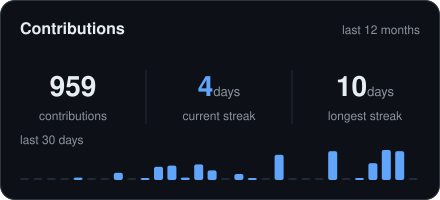
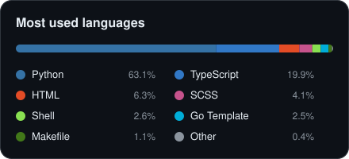
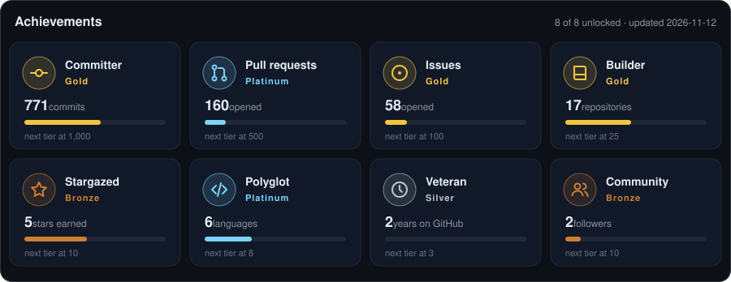
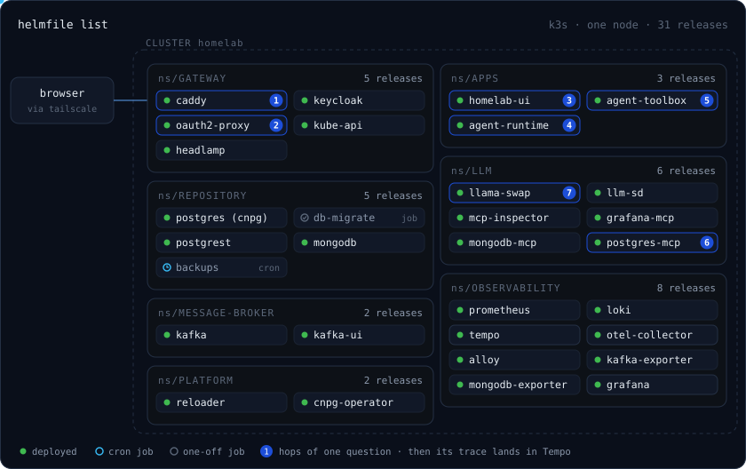

## Activity

  
  
    
  
    
  <picture>
    <source media="(prefers-color-scheme: dark)" srcset="https://raw.githubusercontent.com/s-toufik/s-toufik/output/github-snake-dark.svg" />
    <source media="(prefers-color-scheme: light)" srcset="https://raw.githubusercontent.com/s-toufik/s-toufik/output/github-snake.svg" />
    
  </picture>

## The homelab

**[homelab-infra](https://github.com/s-toufik/homelab-infra)** runs the whole platform on one k3s node, deploying every release with helmfile and the charts from **[kube-charts](https://github.com/s-toufik/kube-charts)**. The map below is read from that helmfile every day. The numbered pods light up in turn to follow one question, from sign-in to the model, and then its trace lands in Tempo.

  

## Nexus, my knowledge hub

**[nexus](https://github.com/s-toufik/nexus)** is where I write down everything I build, why it's built that way, and the ideas behind it, so it can be learned from. It's an Obsidian vault: one note per idea, linked rather than repeated, with decisions that keep their reasons. The graph below is drawn from the vault every day: one dot per note, linked the way the notes link each other.

  

## Repositories

**Agents**
- [agent-runtime](https://github.com/s-toufik/agent-runtime): planning, execution, reflection and decision-making workflows that produce reliable answers
- [agent-toolbox](https://github.com/s-toufik/agent-toolbox): the MCP tool server the agent calls

**Homelab**
- [homelab-ui](https://github.com/s-toufik/homelab-ui): the front door, with every tool as a page and the agent beside it
- [homelab-infra](https://github.com/s-toufik/homelab-infra): the whole platform on one k3s node, deployed with helmfile
- [kube-charts](https://github.com/s-toufik/kube-charts): the Helm charts the homelab runs on

**Knowledge**
- [nexus](https://github.com/s-toufik/nexus): my knowledge hub, an Obsidian vault of projects, ideas, learning paths and sources

**Libraries and templates**
- [pycraftcore](https://github.com/s-toufik/pycraftcore): reusable infrastructure and adapters for Python applications
- [archetype](https://github.com/s-toufik/archetype): a pragmatic hexagonal architecture template for Python, Rust and C++

**pricelab**
- [pricelab-core](https://github.com/s-toufik/pricelab-core): core library of the pricing platform
- [pricelab-retriever](https://github.com/s-toufik/pricelab-retriever): retrieves data from various sources
- [pricelabcpp-core](https://github.com/s-toufik/pricelabcpp-core): the pricelab core in C++
- [pricelabr-core](https://github.com/s-toufik/pricelabr-core): the shared core of the pricelab microservices in Rust (experimental)

**Experiments**
- [web_framework_benchmark](https://github.com/s-toufik/web_framework_benchmark): every web framework under the same load, compared
- [blender](https://github.com/s-toufik/blender): Blender experiments

**Retired**
- [Orion](https://github.com/s-toufik/Orion): a Python API for post-processing large-scale data, now decommissioned

## Stack

**Languages**
 

**AI & backend**
 

**Frontend**
 

**Data & infrastructure**
 

